<picture>
  <source media="(prefers-color-scheme: dark)" srcset="assets/header-dark.svg">
  
</picture>

<p align="center">
  
</p>

<p align="center">
  <a href="https://github.com/MalikMoussaoui?tab=followers"></a>
  
  <a href="https://github.com/MalikMoussaoui/maitre-agent"></a>
</p>

## 🧑‍💻 À propos

```console
chopa@github:~$ cat about.md

👤  Malik « Chopa » Moussaoui
🎓  BUT Informatique · IUT du Limousin
🛠️  Dev full-stack, FiveM / GTA RP (Lua), jeux Roblox (Luau)
🤖  Bots Discord, SaaS, et agents IA pilotés avec Claude Code
🔭  En ce moment : mon portfolio en Astro + Three.js
🎮  Hors du code : esport, création de contenu, jeux vidéo

chopa@github:~$ ▍
```

## 🛠️ Stack

<p align="center"><sub><b>LANGAGES</b></sub><br>
  <picture>
    <source media="(prefers-color-scheme: dark)" srcset="https://skillicons.dev/icons?i=typescript%2Cjavascript%2Clua%2Cpython%2Cjava%2Ckotlin%2Cdart%2Cswift%2Ccs%2Cbash&theme=dark">
    
  </picture>
</p>

<p align="center"><sub><b>FRONT</b></sub><br>
  <picture>
    <source media="(prefers-color-scheme: dark)" srcset="https://skillicons.dev/icons?i=react%2Cnextjs%2Cvuejs%2Castro%2Ctailwindcss%2Cthreejs%2Cvite%2Cflutter%2Chtml%2Ccss&theme=dark">
    
  </picture>
</p>

<p align="center"><sub><b>BACK</b></sub><br>
  <picture>
    <source media="(prefers-color-scheme: dark)" srcset="https://skillicons.dev/icons?i=nodejs%2Cdiscordjs%2Cprisma%2Cmongodb%2Cpostgresql%2Csqlite%2Cspring%2Cdocker%2Cnginx&theme=dark">
    
  </picture>
</p>

<p align="center"><sub><b>JEUX &amp; OUTILS</b></sub><br>
  <picture>
    <source media="(prefers-color-scheme: dark)" srcset="https://skillicons.dev/icons?i=robloxstudio%2Cgit%2Cgithub%2Cgithubactions%2Cvscode%2Cpnpm&theme=dark">
    
  </picture><br>
  
  
</p>

## 📊 En chiffres

<p align="center">
  <picture>
    <source media="(prefers-color-scheme: dark)" srcset="assets/stats-dark.svg">
    
  </picture>
  <picture>
    <source media="(prefers-color-scheme: dark)" srcset="assets/langs-dark.svg">
    
  </picture>
</p>

<p align="center"><sub>Dépôts publics et privés · mis à jour chaque jour par GitHub Actions</sub></p>

## 🚀 Projet à la une

<p align="center">
  <a href="https://github.com/MalikMoussaoui/maitre-agent"><picture>
    <source media="(prefers-color-scheme: dark)" srcset="assets/repo-maitre-agent-dark.svg">
    
  </picture></a>
</p>

### 🔒 En coulisses (dépôts privés)

| | |
|---|---|
| 🚓 **FiveM / GTA RP** | Scripts Lua sur mesure (customs, recoil, médias) et outils pour serveurs RP |
| 🧱 **Roblox** | Jeux en Luau, en solo et en équipe |
| 🤖 **Bots Discord & SaaS** | Next.js, Fastify, Stripe, MongoDB, Socket.io |
| 🧠 **IA** | Une IA suivie en direct dans une expérience sociale, des agents qui se pilotent entre eux |
| 📱 **Mobile** | Flutter, Kotlin, Swift |

## 🐍 Mes contributions, version snake

<picture>
  <source media="(prefers-color-scheme: dark)" srcset="https://raw.githubusercontent.com/MalikMoussaoui/MalikMoussaoui/output/snake-dark.svg">
  
</picture>

## 📫 Me trouver

<p align="center">
  
  <a href="mailto:amalik.moussaoui1710@gmail.com"></a>
</p>


